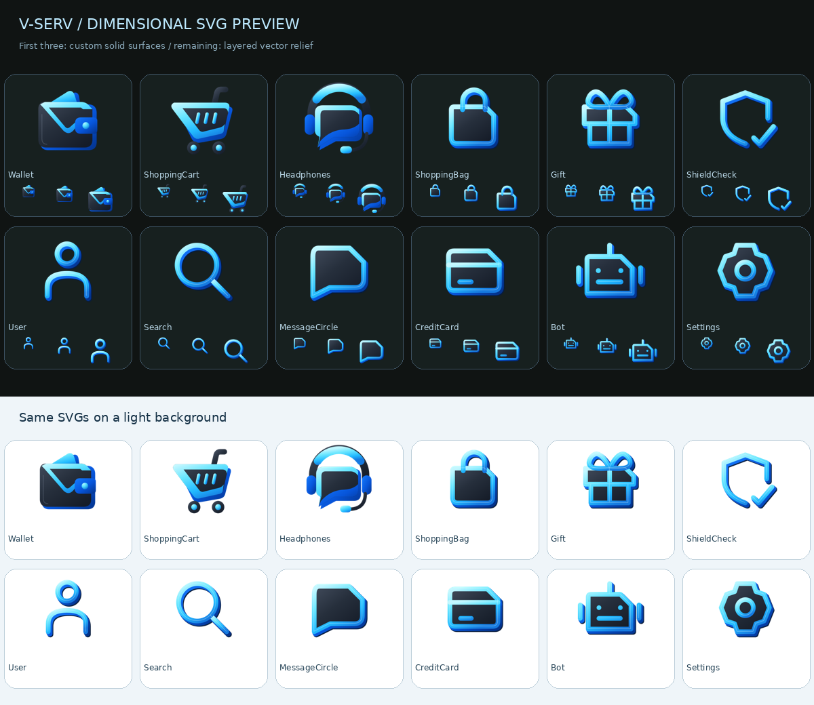

# @vserv/icons

Dimensional and monochrome React icons with a graphite, ice-blue and royal-blue palette.



## Icon families

| Family | Contents | Best suited for |
| --- | --- | --- |
| Soft Depth SVG | 157 designs, 170 named exports including aliases | Navigation, cards and illustrations at 32–128px |
| Monochrome SVG | The same 170 names, using `currentColor` | Controls and compact interfaces at 16–24px |
| Transparent PNG | 157 designs at 64, 256 and 512px | Tools that require raster images |
| Studio PNG | Wallet, ShoppingCart and Headphones | Larger decorative illustrations |

Both SVG families use a 24 × 24 grid. Wallet, ShoppingCart and Headphones have custom surface geometry; the remaining dimensional icons use layered vector extrusion. Studio images are separate assets and differ from the corresponding SVGs.

## Installation

The package is not published to npm yet. Build a tarball from this repository:

```sh
git clone https://github.com/mrVXBoT/vserv-icons.git
cd vserv-icons
npm ci
npm pack
```

Install the resulting file in your application:

```sh
npm install /path/to/vserv-icons-0.2.0.tgz
```

React 18.3.1 or React 19 is required as a peer dependency. React is not bundled. The package uses ESM.

## React usage

```tsx
import { Wallet, ShoppingCart } from '@vserv/icons';
import { Wallet as WalletLine } from '@vserv/icons/line';
import { Search } from '@vserv/icons/icons/Search';

<Wallet size={64} title="Wallet" />
<button aria-label="Shopping cart"><ShoppingCart size={32} /></button>
<WalletLine size={20} style={{ color: '#8bdcff' }} />
<Search size={32} />
```

Dimensional icons use fixed brand colors. Monochrome icons inherit `currentColor`. Icons accept SVG attributes, a `size` prop and a forwarded SVG ref. `viewBox` and stroke width are fixed by the design system.

Icons are decorative by default (`aria-hidden="true"`). Supply `title`, `aria-label` or `aria-labelledby` for a standalone accessible image. For an icon-only button, name the button itself. Title and gradient IDs are unique to each React instance.

### Dynamic names

```tsx
import { resolveIcon } from '@vserv/icons/registry';

const Icon = resolveIcon(iconName);
<Icon size={48} />;
```

The optional registry imports every dimensional icon. Unknown names resolve to `Sparkles`. Prefer named imports when the icon is known at build time so unused icons can be tree-shaken.

### Studio images

```tsx
import { WalletRender } from '@vserv/icons/renders';

<WalletRender size={160} alt="Wallet" />;
// Decorative image: alt=""
```

Render components use `new URL(..., import.meta.url)` for asset resolution. Vite and Webpack can process these URLs; SSR applications can supply their own public `src`. Importing SVG components does not load studio PNGs.

### Direct imports and files

| Path | Contents |
| --- | --- |
| `@vserv/icons` | Dimensional React components |
| `@vserv/icons/icons/Wallet` | One dimensional component |
| `@vserv/icons/line` | Monochrome React components |
| `@vserv/icons/line/icons/Wallet` | One monochrome component |
| `@vserv/icons/svg/wallet.svg` | Monochrome SVG source |
| `@vserv/icons/dimensional/svg/wallet.svg` | Dimensional SVG source |
| `@vserv/icons/png/256/wallet.png` | Rasterized dimensional SVG |
| `@vserv/icons/renders/wallet.png` | Studio image |
| `@vserv/icons/depth` | Three experimental monochrome depth components |

## Gallery

```sh
npm run preview
```

Open <http://127.0.0.1:4178> to search icons, filter categories, switch themes and download SVG or PNG files.

## Development

```sh
npm ci
npm run build
npm test
npm pack
```

Edit `svg/` for monochrome geometry and `dimensional/svg/` for dimensional geometry. React components in `src/icons/` and `src/dimensional/` are generated during the build. Existing dimensional SVG geometry is retained; missing dimensional sources receive an initial extrusion from the monochrome source.

To update PNG exports after changing dimensional SVGs:

```sh
# Requires Pillow, pycairo, PyGObject and librsvg.
python3 scripts/render-dimensional.py
```

PNG files are included in the package; consumers do not need Python.

### Browser checks

```sh
npx playwright install chromium
npm run test:visual
```

The visual suite compares four gallery screenshots (dark/light × RTL/LTR), checks accessibility with axe, and exercises search and keyboard focus. Run it with the same browser, OS and fonts as the baselines. After reviewing an intentional visual change, update the baselines:

```sh
UPDATE_VISUAL=1 npm run test:visual
```

### Migration audit

```sh
npm run audit -- /path/to/application/src
```

The audit scans supplied source folders for `lucide-react` references and reports unsupported names. Local reports are written under `tests/results/audit/`, which is excluded from Git. Runtime names from APIs and databases need a separate check.

## Documentation

- [Design](docs/design.md)
- [Migration guide](docs/migration.md)
- [Export name mapping](docs/migration-matrix.md)
- [Validation](docs/validation.md)
- [Changelog](CHANGELOG.md)

## Versioning and license

Version 0.2.0 moves monochrome exports to `/line` and makes Soft Depth the default. Breaking changes may occur in minor releases before 1.0.

Licensed under the [MIT License](LICENSE).
